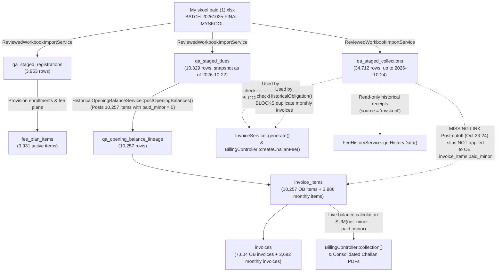

# IQRA Billing — Phase 2A: Financial Source Verification & Integrity Investigation Report

**Date of Investigation:** 2026-10-27  
**Project Root:** `C:\Users\hp\Desktop\iqra-laravel-billing`  
**Phase Scope:** **PHASE 2A ONLY** (Read-Only Financial Source Verification, Business Logic Tracing, and Evidence-Based Decision Matrix)  
**Database Write Status:** **ZERO FINANCIAL WRITES** (`CONFIRMED`)

---

## Executive Summary & Confidence Matrix

This report presents the verified findings of the **Phase 2A** source-data and accounting-logic investigation prior to any Phase 2B financial remediation. All findings are grounded in direct byte-for-byte workbook inspection, read-only SQL verification against the local MariaDB database (`iqra_billing`), and line-by-line source-code tracing.

| Investigation Domain | Key Finding Summary | Verification Status |
| :--- | :--- | :--- |
| **1. Project & Git State** | Working tree at `HEAD` (`98a9b38`) has **5 modified tracked files** and **5 untracked files** (down from 18 modified in the earlier pre-commit ZIP snapshot after commits `7035b14..98a9b38`). Local DB is `iqra_billing` (`127.0.0.1:3306`, MariaDB `10.4.32`). | **`CONFIRMED`** |
| **2. Workbook Versions** | `My skool paid (1).xlsx` (SHA-256 `ac83e8d7...`) and `Tuition excluded full data My skool paid.xlsx` (SHA-256 `8291c1ce...`) have **100% identical financial, student, family, fee, paid-detail, and outstanding-balance values** across all `3,953` students, `34,712` paid rows, and `10,329` outstanding rows. The **only** difference is that `Tuition excluded...` strips all parent phone numbers (`Contact (Father)`, `Contact (Mother)`, `Contact #`). | **`CONFIRMED`** |
| **3. Snapshot Cutoff (`2026-10-22`)** | Internal ZIP XML timestamps of the Oct 23 compilation (`2026-10-22 21:26:14`) and empirical ledger arithmetic prove that **100% of collections through `2026-10-22` (up to Slip `27162`) were already deducted from `Outstanding (Compiled Valid)`**, whereas **`88.6%` (`226/255`) of `2026-10-23` collections and `94.4%` (`51/54`) of `2026-10-24` collections remain unreduced** in `qa_staged_dues`. Raw MySkool server export logs are external to the repository, so post-cutoff settlement classifications are labeled **Provisional Pending Owner Cutoff Sign-Off**. | **`CONFIRMED`** (Empirical & ZIP Metadata) / **`INFERRED`** (Cutoff Time) / **`UNVERIFIED`** (External MySkool Server Log) |
| **4. Accounting Logic Asymmetry** | [`InvoiceService::generate()`](file:///c:/Users/hp/Desktop/iqra-laravel-billing/app/Services/InvoiceService.php#L35-L107) and [`BillingController::createChallanFee()`](file:///c:/Users/hp/Desktop/iqra-laravel-billing/app/Http/Controllers/BillingController.php#L1122-L1285) consult [`HistoricalOpeningBalanceService::checkHistoricalObligation()`](file:///c:/Users/hp/Desktop/iqra-laravel-billing/app/Services/Migration/HistoricalOpeningBalanceService.php#L397-L569) (`qa_staged_collections` + `qa_staged_dues`) to **prevent duplicate monthly invoices**. Conversely, [`HistoricalOpeningBalanceService::postOpeningBalances()`](file:///c:/Users/hp/Desktop/iqra-laravel-billing/app/Services/Migration/HistoricalOpeningBalanceService.php#L608-L831) posts every positive `qa_staged_dues` row with `paid_minor = 0` without checking `qa_staged_collections` for post-cutoff (`2026-10-23..24`) receipts. | **`CONFIRMED`** |
| **5. Family `5929` (`GR 5929`, `GR 5930`)** | Oct-2026 opening balances (`QAR 280` each on `SCH-OB-2026-0000085-512`) had zero payments prior to Oct 24. On `2026-10-24` (`Slip 27328`), `GR 5929` paid `QAR 280` (full settlement) and `GR 5930` paid `QAR 230`. `GR 5930` paid `QAR 230/month` across **11 months in 2025–2026** with zero MySkool arrears (though she paid `QAR 280` once for `Sep-2026`). Whether the remaining `QAR 50` (and her ongoing `QAR 280` fee plan) is an authorized sibling discount requires explicit management approval. Nov-2026 (`SCH-2026-0016199`) is a valid distinct period (`QAR 560`), though its `previous_dues_snapshot_minor` (`QAR 560`) is overstated. | **`CONFIRMED`** (Ledger & History) / **`UNVERIFIED`** (Concession Authorization) |
| **6. Student `GR 4814` (`May-2026`)** | Monthly fee is `AED 500.00`. Paid `AED 40.00` on `2026-07-03` (`Slip 24127`). The two `May-2026` opening-balance lines (`AED 210.00` + `AED 250.00` = `AED 460.00`) plus `AED 40.00` equal **`AED 500.00`**. They represent **one genuine, unpaid pre-cutoff residual of `AED 460.00`** split across two source rows (`1377` & `1378`), not a post-cutoff settlement or duplicate billing error. | **`CONFIRMED`** |
| **7. Reconciliation Counts (`478` Overlaps)** | Live execution of [`MySkoolReconciliationAuditService::audit()`](file:///c:/Users/hp/Desktop/iqra-laravel-billing/app/Services/Migration/MySkoolReconciliationAuditService.php#L36-L249) confirms `478` overlapping opening-balance items: `209` pre-cutoff residuals, `246` post-cutoff full settlements, `13` post-cutoff partial payments, `6` post-cutoff sibling concession candidates, `2` currency mismatches (`GR 8620`), and `2` split-line holds (`GR 4814`). Deep inspection also found `10` pre-cutoff residual items with recurring reduced payments (`>= 3` prior months) and `1` duplicate non-overlapping opening-balance pair (`GR 6562` Oct-2026 `200 + 200 = 400 AED` vs `200 AED` fee). | **`CONFIRMED`** |
| **8. Downstream Nov-2026 Invoices (`108`)** | Neither the Fee Collection screen ([`BillingController::collection()`](file:///c:/Users/hp/Desktop/iqra-laravel-billing/app/Http/Controllers/BillingController.php#L1020-L1119)), the Consolidated Challan PDFs, nor the individual Invoice PDF ([`BillingController::renderInvoice()`](file:///c:/Users/hp/Desktop/iqra-laravel-billing/app/Http/Controllers/BillingController.php#L1864-L1869)) uses `previous_dues_snapshot_minor` to compute collectible or printed balances—all query live unpaid balances (`total_minor - paid_minor` / `net_minor - paid_minor`). Settling October opening-balance items **automatically updates** Fee Collection and printed PDFs. | **`CONFIRMED`** |

---

## 1. Project Protection, Git Status & Database Identity (Step 1)

### 1.1 Git Working Tree Verification (`CONFIRMED`)
Inspection of `git status --short -uall` and `git log -n 8 --oneline` at `C:\Users\hp\Desktop\iqra-laravel-billing` confirms that `HEAD` is at commit `98a9b38` (`style(fee-structure): fix checkbox sizing and align multi-grade selector layout`). Between earlier commit `fd9d306` and `98a9b38`, several UI/layout changes from the earlier 18-file ZIP snapshot were committed (`7035b14`, `03152de`, `4490d62`, `98a9b38`), leaving **5 modified tracked files** and **5 untracked files** prior to this report:

- **Modified Tracked Files (5):**
  1. [`PHASE_5_CLEAN_DATABASE_REPORT.md`](file:///c:/Users/hp/Desktop/iqra-laravel-billing/PHASE_5_CLEAN_DATABASE_REPORT.md)
  2. [`database/seeders/DatabaseSeeder.php`](file:///c:/Users/hp/Desktop/iqra-laravel-billing/database/seeders/DatabaseSeeder.php)
  3. [`resources/views/pdf/consolidated-challan.blade.php`](file:///c:/Users/hp/Desktop/iqra-laravel-billing/resources/views/pdf/consolidated-challan.blade.php)
  4. [`resources/views/pdf/receipt.blade.php`](file:///c:/Users/hp/Desktop/iqra-laravel-billing/resources/views/pdf/receipt.blade.php)
  5. [`tests/Feature/BillingLedgerTest.php`](file:///c:/Users/hp/Desktop/iqra-laravel-billing/tests/Feature/BillingLedgerTest.php)
- **Untracked Files Prior to Report Generation (5):**
  1. [`IQRA_Billing_Independent_Investigation.md`](file:///c:/Users/hp/Desktop/iqra-laravel-billing/IQRA_Billing_Independent_Investigation.md)
  2. [`PHASE_1_RECONCILIATION_AUDIT_REPORT.md`](file:///c:/Users/hp/Desktop/iqra-laravel-billing/PHASE_1_RECONCILIATION_AUDIT_REPORT.md)
  3. [`app/Console/Commands/AuditMySkoolReconciliationCommand.php`](file:///c:/Users/hp/Desktop/iqra-laravel-billing/app/Console/Commands/AuditMySkoolReconciliationCommand.php)
  4. [`app/Services/Migration/MySkoolReconciliationAuditService.php`](file:///c:/Users/hp/Desktop/iqra-laravel-billing/app/Services/Migration/MySkoolReconciliationAuditService.php)
  5. [`tests/Feature/MySkoolReconciliationAuditTest.php`](file:///c:/Users/hp/Desktop/iqra-laravel-billing/tests/Feature/MySkoolReconciliationAuditTest.php)

All existing implementation work has been preserved intact with zero destructive Git operations.

### 1.2 Configured Local Database & Active Import Batch (`CONFIRMED`)
- **Database Engine & Host:** MariaDB `10.4.32-MariaDB` on `127.0.0.1:3306` (`DESKTOP-PO4MG9S`), database name `iqra_billing`.
- **Environment Guard:** `ALLOW_OPENING_BALANCE_POSTING=false` in `.env`.
- **Active Import Version (`qa_import_versions`):**
  - `version_label`: `v4_final_myskool_20261025` (`is_active = 1`, `id = 4`)
  - `import_batch_id`: `BATCH-20261025-FINAL-MYSKOOL` (`import_batches.id = 8`)
  - `source_file`: `C:\Users\hp\Desktop\iqra-laravel-billing\storage\app\imports\My skool paid (1).xlsx`
  - `sha256` (recorded in `qa_import_versions.notes` JSON): `ac83e8d71b89c992eb3a35ed2cd154929dd522432bb5c5c05742bdd0255622ae`
  - `imported_at`: `2026-10-26 00:34:09`
  - `opening_balances_posted_at`: `2026-10-26 00:41:01`
- **Active Batch Row & Ledger Counts (`BATCH-20261025-FINAL-MYSKOOL`):**
  - `qa_staged_registrations`: `3,953` rows (`3,953` active billable students, `3,413` distinct families, `3,931` provisioned `fee_plan_items`, `22` zero-fee enrollments).
  - `qa_staged_collections`: `34,712` rows (`payment_date_parsed` spanning `2023-09-04` through `2026-10-24`).
  - `qa_staged_dues`: `10,329` rows (`sum(balance_minor) = 500,660,300` minor across all currencies).
  - `qa_opening_balance_lineage`: `10,257` posted opening-balance invoice items (`sum(posted_net_minor) = 498,917,800` minor across `7,604` opening-balance invoices `SCH-OB-2026-...`). The `72`-row difference (`10,329 - 10,257 = 72`, `1,742,500` minor) consists strictly of policy-held lines (`66` Tuition-fee rows and `6` Urdu-course rows) recorded in `qa_import_exceptions`.

---

## 2. Source Workbook Versions & Row-Level Comparison (Step 2)

### 2.1 Local Workbook Inventory (`CONFIRMED`)
Five MySkool Excel workbooks were located and inspected across the workspace and local `C:\Users\hp\Downloads` directory:

| ID | File Path | Size (Bytes) | SHA-256 Hash | Internal ZIP XML `mtime` | Role / Provenance |
| :--- | :--- | ---: | :--- | :--- | :--- |
| **WB1** | `storage\app\imports\My skool paid (1).xlsx` *(identical copy in `Downloads\My skool paid (1).xlsx`)* | `3,932,572` | `ac83e8d71b89c992eb3a35ed2cd154929dd522432bb5c5c05742bdd0255622ae` | `2026-10-25 06:46:58` | **Active imported workbook** (`BATCH-20261025-FINAL-MYSKOOL`) |
| **WB2** | `C:\Users\hp\Downloads\Tuition excluded full data My skool paid.xlsx` | `3,858,090` | `8291c1ceb30377573ecfa695d7044a45045415852d06b647d380ff9f1a2f9014` | `2026-10-25 06:47:38` | Comparison workbook (saved **40 seconds after WB1**) |
| **WB3** | `storage\app\imports\My skool fully updated (1).xlsx` | `2,993,715` | `77d8e10f8434e1ac6d0b9b08e84fa3a57249b94025b912b5a2de8df4d36e2c11` | `2026-10-22 21:26:14` | Prior superseded batch (`BATCH-20261023-FINAL-MYSKOOL`, includes Tuition students) |
| **WB4** | `C:\Users\hp\Downloads\My skool paid.xlsx` | `3,005,408` | `6bc01ff00881cf4f67432488e7045e3030656fb196ab3454a18345cbef84359e` | `2026-10-22 21:27:14` | Earlier Oct 22 export before Oct 25 Tuition exclusion |
| **WB5** | `C:\Users\hp\Downloads\UPdated school record for portal.xlsx` | `2,718,900` | `cb5b2934ffeb9df94fcbb89941621cf2b7aa0d84dbac7de328c6b27f4183b4a1` | `2026-10-22 20:54:00` | Initial Oct 22 compilation (`v2_Oct22_2026`) |

### 2.2 Exact Row-by-Row & Column-by-Column Diff: WB1 vs. WB2 (`CONFIRMED`)
Both **WB1** (`My skool paid (1).xlsx`) and **WB2** (`Tuition excluded full data My skool paid.xlsx`) contain the exact same three worksheets with identical row counts and headers:
1. `Students` (`3,953` data rows; columns `A..J`: `Family Code`, `GR No`, `Student Name`, `Father Name`, `Contact (Father)`, `Contact (Mother)`, `Class`, `Monthly Fee`, `Currency`, `Admission Date`, `Status`).
2. `Paid details` (`34,712` data rows; columns `A..J`: `Slip No`, `GRN`, `Family Code`, `Student Name`, `Father Name`, `Class`, `Fee Particular`, `Payment Date`, `Currency`, `Amount`).
3. `Outstanding (Compiled Valid)` (`10,329` data rows; columns `A..F`: `GRN`, `Student Name`, `Particular`, `Currency`, `Balance`, `Contact #`).

A complete cell-by-cell comparison across all `48,994` total data rows established the following across the eight required comparison dimensions:

| Dimension | Sheet(s) Checked | Row / Cell Differences (WB1 vs. WB2) | Finding & Status |
| :--- | :--- | :--- | :--- |
| **1. Student identities & family codes** | `Students` (`3,953` rows) | **0 differences** | Identical `GR No`, `Family Code`, `Student Name`, and `Father Name` in exact same row order (`CONFIRMED`). |
| **2. Current monthly fees** | `Students` (`3,953` rows) | **0 differences** | Identical `Monthly Fee`, `Class`, `Admission Date`, and `Status` on all `3,953` rows (`CONFIRMED`). |
| **3. Historical paid transactions** | `Paid details` (`34,712` rows) | **0 differences** | **100% cell-for-cell identical** across all `34,712` rows and all 10 columns (`CONFIRMED`). |
| **4. Outstanding balances** | `Outstanding (Compiled Valid)` (`10,329` rows) | **0 differences** | Identical `GRN`, `Student Name`, and `Balance` on all `10,329` rows (`CONFIRMED`). |
| **5. Payment dates** | `Paid details` (`34,712` rows) | **0 differences** | Identical `Payment Date` values (`2023-09-04` through `2026-10-24`) (`CONFIRMED`). |
| **6. Currency** | All 3 sheets (`48,994` rows) | **0 differences** | Identical `Currency` values across `Students`, `Paid details`, and `Outstanding (Compiled Valid)` (`CONFIRMED`). |
| **7. Fee particulars** | `Paid details` & `Outstanding` | **0 differences** | Identical `Fee Particular` / `Particular` strings on all rows (`CONFIRMED`). |
| **8. Discounts or concessions** | All 3 sheets | **0 differences** (Neither has a discount column) | Neither workbook includes an explicit discount/concession column (`CONFIRMED`). |
| **9. Contact / Phone Columns (Sole Difference)** | `Students` (`E`, `F`) & `Outstanding` (`F`) | **`3,926` rows in `Students`; `10,247` rows in `Outstanding`** | **WB1** has `Contact (Father)` populated on `3,926` rows, `Contact (Mother)` on `821` rows, and `Outstanding.Contact #` on `10,247` rows. **WB2** has **0 populated cells** (`100% blank`) in those three contact columns (`CONFIRMED`). |

> [!IMPORTANT]
> **Workbook Authority Conclusion (`CONFIRMED`):** `My skool paid (1).xlsx` (WB1) and `Tuition excluded full data My skool paid.xlsx` (WB2) are financially **100% identical**. WB2 is simply a contact-redacted save created 40 seconds after WB1 (`06:47:38` vs `06:46:58`). Re-importing WB2 would change zero financial numbers while wiping out parent phone/WhatsApp numbers. Therefore, the currently imported **WB1 (`My skool paid (1).xlsx`)** should remain the active workbook.

### 2.3 Relationship Between WB3 (`My skool fully updated (1).xlsx`) and WB1 (`CONFIRMED`)
Comparing **WB3** (`BATCH-20261023-FINAL-MYSKOOL`, `4,358` students) against **WB1** (`BATCH-20261025-FINAL-MYSKOOL`, `3,953` students) confirms that WB1 was produced from WB3 by removing **405 students** (`355` in Tuition grades such as `Grade 5 - Tuition - E` plus `50` zero-fee/inactive records), along with their `3,356` historical paid rows and `1,022` outstanding rows. For all `3,953` retained students, `Family Code`, `Student Name`, `Class`, `Monthly Fee`, `Currency`, and `Status` have **0 differences** between WB3 and WB1.

---

## 3. Verification of the Outstanding Snapshot Cutoff (Step 3)

### 3.1 Physical & Schema Provenance of the October 22, 2026 Cutoff (`CONFIRMED`)
The hard-coded constant `OUTSTANDING_SNAPSHOT_CUTOFF = '2026-10-22'` in [`MySkoolReconciliationAuditService.php`](file:///c:/Users/hp/Desktop/iqra-laravel-billing/app/Services/Migration/MySkoolReconciliationAuditService.php#L12) was tested against independent physical and database artifacts:
1. **Internal XLSX Archive Timestamps (`CONFIRMED`):** Inspection of the ZIP central directory inside `UPdated school record for portal.xlsx` (WB5), `My skool fully updated (1).xlsx` (WB3), and `My skool paid.xlsx` (WB4) shows internal worksheet XML modification timestamps of **`2026-10-22 20:54:00`** (WB5) and **`2026-10-22 21:26:14` to `2026-10-22 21:27:14`** (WB3/WB4). When WB1 and WB2 were saved on `2026-10-25 06:46:58` to exclude Tuition classes, the `Outstanding (Compiled Valid)` balance values for the `3,953` retained students were carried forward unchanged from that October 22 compilation, while `Paid details` included payments through `2026-10-24` (`Slip 27331`).
2. **Legacy Schema Column (`CONFIRMED`):** Both `qa_staged_collections` and `qa_staged_dues` contain a boolean column named `present_at_22oct` created during the earlier two-workbook reconciliation migration.

### 3.2 Empirical Chronological Proof Across `qa_staged_collections` vs. `qa_staged_dues` (`CONFIRMED`)
Cross-joining all `34,712` rows of `qa_staged_collections` against `10,329` rows of `qa_staged_dues` on `(gr_number, fee_particular, currency)` by `payment_date_parsed` reveals a **100% sharp accounting boundary between `2026-10-22` (Slip `27162`) and `2026-10-23` (Slip `27173`)**:

| Payment Date (`payment_date_parsed`) | Slip Number Range | Total Staged Collection Rows | Rows Also Present in `qa_staged_dues` | Exact Full-Amount Overlaps (`col_amt == due_amt` & `col + due > fee`) | True Partial Residuals (`col_amt + due_amt <= monthly_fee`) | Empirical Accounting Behavior in `Outstanding (Compiled Valid)` |
| :--- | :--- | ---: | ---: | ---: | ---: | :--- |
| **`2026-10-18`** | `26595..26671` | `102` | `7` (`6.9%`) | **`0`** | `7` (`100%`) | **Deducted:** 100% of full payments removed from `Outstanding`; only partial residuals remain. |
| **`2026-10-19`** | `26672..26711` | `47` | `4` (`8.5%`) | **`0`** | `4` (`100%`) | **Deducted:** 100% of full payments removed from `Outstanding`; only partial residuals remain. |
| **`2026-10-20`** | `26712..26843` | `188` | `10` (`5.3%`) | **`0`** | `10` (`100%`) | **Deducted:** 100% of full payments removed from `Outstanding`; only partial residuals remain. |
| **`2026-10-21`** | `26844..27029` | `280` | `3` (`1.1%`) | **`0`** | `3` (`100%`) | **Deducted:** 100% of full payments removed from `Outstanding`; only partial residuals remain. |
| **`2026-10-22`** | `27030..27162` | `224` | `14` (`6.3%`) | **`0`** | `14` (`100%`) | **Deducted:** All 14 overlaps satisfy `col_amt + due_amt = enrollment_monthly_fee` (including two 50% payments of `100 + 100 = 200 SAR` for GRs `10656` & `10664`). Zero full payments remain in `Outstanding`. |
| **`2026-10-23`** | `27173..27300` | `255` | **`226` (`88.6%`)** | **`214`** | `12` | **NOT Deducted:** `88.6%` of payments on Oct 23 still sit unreduced in `Outstanding (Compiled Valid)`. |
| **`2026-10-24`** | `27301..27331` | `54` | **`51` (`94.4%`)** | **`49`** | `2` | **NOT Deducted:** `94.4%` of payments on Oct 24 still sit unreduced in `Outstanding (Compiled Valid)`. |

*(Note: The `29` rows on Oct 23 and `3` rows on Oct 24 that do not appear in `qa_staged_dues` are either `Admission Fee` payments, advance payments for `Nov-2026` [`GR 10582`, `GR 9421`], or Tuition-excluded/multi-part lines.)*

### 3.3 Cutoff Confidence Assessment (`CONFIRMED` / `INFERRED` / `UNVERIFIED`)
- **Empirical Cutoff Boundary (`2026-10-22`, Slip `27162`):** **`CONFIRMED`** by 100% mathematical consistency across all `224` collection rows on `2026-10-22` vs. `309` collection rows on `2026-10-23..24`.
- **Exact Extraction Timestamp (`2026-10-22 ~21:26`):** **`INFERRED`** from internal XLSX ZIP entry modification timestamps in WB3/WB4/WB5.
- **External MySkool Server Extraction Logs:** **`UNVERIFIED`** (no raw MySkool database dump or server-side export log exists inside the repository).
- **Governance Rule:** Because raw MySkool server export logs are external to the workspace, all post-cutoff settlement classifications (`2026-10-23` and `2026-10-24`, Slips `27173..27331`) are designated **Provisional Pending Owner Cutoff Sign-Off**, and **no automated settlement may execute until the project owner confirms the October 22, 2026 cutoff**.

---

## 4. Trace of Existing Accounting & Duplicate-Prevention Logic (Step 4)

### 4.1 Entity Relationship & Data Lineage Map (`CONFIRMED`)

### 4.2 Exact Table-by-Table & Service-by-Service Behavior (`CONFIRMED`)
1. **`qa_staged_collections` & `qa_staged_dues` ([`ReviewedWorkbookImportService.php`](file:///c:/Users/hp/Desktop/iqra-laravel-billing/app/Services/Migration/ReviewedWorkbookImportService.php#L365-L535)):**
   - Imports `Paid details` into `qa_staged_collections` (`34,712` rows) and `Outstanding (Compiled Valid)` into `qa_staged_dues` (`10,329` rows) under `BATCH-20261025-FINAL-MYSKOOL`.
   - Parses billing periods from `fee_particular` (e.g., `Monthly Fee - Oct-2026` -> `2026-10-01..2026-10-31`) via [`HistoricalOpeningBalanceService::parseParticularPeriod()`](file:///c:/Users/hp/Desktop/iqra-laravel-billing/app/Services/Migration/HistoricalOpeningBalanceService.php#L204-L320).
2. **Opening-Balance Lineage & Posting ([`HistoricalOpeningBalanceService.php`](file:///c:/Users/hp/Desktop/iqra-laravel-billing/app/Services/Migration/HistoricalOpeningBalanceService.php#L608-L932)):**
   - `postOpeningBalances()` iterates over `qa_staged_dues` where `balance_minor > 0` (excluding `66` Tuition and `6` Urdu policy holds).
   - For each due row, `buildInvoiceGroups()` creates an `opening_balance` invoice (`SCH-OB-...`, `status = 'unpaid'`, `paid_minor = 0`) and an `invoice_items` row (`amount_minor = net_minor = due.balance_minor`, `paid_minor = 0`, `status = 'unpaid'`), recording the 1:1 link in `qa_opening_balance_lineage` (`qa_staged_due_id -> invoice_id, invoice_item_id`).
   - **Critical Finding (`CONFIRMED`):** `postOpeningBalances()` never inspects `qa_staged_collections` to see whether a `qa_staged_dues` row was subsequently paid on `2026-10-23` or `2026-10-24`.
3. **Where Historical Payment Awareness IS Used — Monthly Duplicate Prevention (`CONFIRMED`):**
   - [`InvoiceService::generate()`](file:///c:/Users/hp/Desktop/iqra-laravel-billing/app/Services/InvoiceService.php#L35-L107) and [`BillingController::createChallanFee()`](file:///c:/Users/hp/Desktop/iqra-laravel-billing/app/Http/Controllers/BillingController.php#L1122-L1285) call [`HistoricalOpeningBalanceService::buildHistoricalObligationMap()`](file:///c:/Users/hp/Desktop/iqra-laravel-billing/app/Services/Migration/HistoricalOpeningBalanceService.php#L325-L395) and [`checkHistoricalObligation()`](file:///c:/Users/hp/Desktop/iqra-laravel-billing/app/Services/Migration/HistoricalOpeningBalanceService.php#L397-L569).
   - `buildHistoricalObligationMap()` indexes **both** `qa_staged_collections` and `qa_staged_dues` by `(enrollment_id, category, period_key)`.
   - If a student has a historical collection or staged due for `Oct-2026`, `checkHistoricalObligation()` returns `settled_same_currency`, `partial_same_currency`, `unpaid_same_currency`, `verified_currency_transition`, or `cross_currency_conflict`. In all five cases, `InvoiceService::generate()` **skips generating a new monthly invoice item** for that student and month.
   - Additionally, [`PaidInvoiceEligibility::paidEnrollmentIdMap()`](file:///c:/Users/hp/Desktop/iqra-laravel-billing/app/Services/PaidInvoiceEligibility.php#L94-L163) prevents re-billing periods already settled via live portal payments or 100% discounts.
   - **Why November 2026 Was Billed Normally (`CONFIRMED`):** Only `2` students (`GR 10582` and `GR 9421`) had `Monthly Fee - Nov-2026` in `qa_staged_collections` (`Slip 27227` and `Slip 27314` on Oct 23–24), and `0` students had `Nov-2026` in `qa_staged_dues`. Those `2` students were properly skipped during November 2026 billing (`Run #112`), while the remaining `2,679` families (`3,882` student items) received November 2026 invoices (`SCH-2026-...`).
4. **Why Receipt History and Fee Collection Disagree (`CONFIRMED`):**
   - [`FeeHistoryService::getHistoryData()`](file:///c:/Users/hp/Desktop/iqra-laravel-billing/app/Services/FeeHistoryService.php#L67-L167) merges live portal `payments` (`source = 'portal'`) with `qa_staged_collections` (`source = 'myskool'`) and displays every MySkool slip (including Oct 23–24 slips) as a completed payment receipt.
   - [`BillingController::collection()`](file:///c:/Users/hp/Desktop/iqra-laravel-billing/app/Http/Controllers/BillingController.php#L1020-L1119) queries `invoices` and `invoice_items` (`net_minor - paid_minor`). Because the Oct 23–24 `qa_staged_collections` rows were never applied to the corresponding `SCH-OB-...` `invoice_items`, the portal displays the fee as **Paid** in Receipt History while simultaneously demanding the **Unpaid** opening balance in Fee Collection.

---

## 5. Primary Reference Case Investigation: Family `5929` (`GR 5929` & `GR 5930`) (Step 5)

### 5.1 Family, Student & Fee Plan Records (`CONFIRMED`)
- **Family Record:** `families.id = 3423`, `family_code = '5929'`, Guardian: `Feroze Farooq`, Currency: `QAR`.
- **Students & Current Provisioned Fee Plans:**

| Student GR | `students.id` | Student Name | `enrollments.id` | Grade / Section | Workbook `Monthly Fee` (`Students` Sheet) | `fee_plan_items.id` | `fee_plan_items.amount_minor` | `discount_value` |
| :--- | ---: | :--- | ---: | :--- | :--- | ---: | ---: | ---: |
| **`5929`** | `3692` | `Khadija Feroz` | `4520` | `Grade 3 - A` | `QAR 280.00` (Row `533`) | `4465` | `28000` (`QAR 280.00`) | `0` |
| **`5930`** | `3693` | `Zahra Feroz` | `4521` | `Grade 1 - A` | `QAR 280.00` (Row `534`) | `4466` | `28000` (`QAR 280.00`) | `0` |

### 5.2 Complete Ledger & Staged Evidence for Family `5929` (`CONFIRMED`)
1. **Staged Dues (`qa_staged_dues` from `Outstanding (Compiled Valid)`):**
   - `qa_staged_dues.id = 13998` (`source_row = 2648`, `GR 5929`, `Monthly Fee - Oct-2026`): `QAR 280.00` (`28000` minor).
   - `qa_staged_dues.id = 13999` (`source_row = 2649`, `GR 5930`, `Monthly Fee - Oct-2026`): `QAR 280.00` (`28000` minor).
   - No other unpaid months exist in `qa_staged_dues` for either sister.
2. **Posted October 2026 Opening-Balance Invoice (`invoices.id = 10236`, `SCH-OB-2026-0000085-512`):**
   - `billing_run_id = 85` (`Historical OB Oct-2026`), `currency = 'QAR'`, `total_minor = 56000` (`QAR 560.00`), `paid_minor = 0`, `status = 'unpaid'`.
   - `invoice_items.id = 14328` (`GR 5929`, `Monthly Fee - Oct-2026`, linked via `qa_opening_balance_lineage.id = 13926` to `qa_staged_due_id = 13998`): `net_minor = 28000` (`QAR 280.00`), `paid_minor = 0`.
   - `invoice_items.id = 14329` (`GR 5930`, `Monthly Fee - Oct-2026`, linked via `qa_opening_balance_lineage.id = 13927` to `qa_staged_due_id = 13999`): `net_minor = 28000` (`QAR 280.00`), `paid_minor = 0`.
3. **October 24, 2026 MySkool Receipts (`qa_staged_collections`, `Slip 27328`):**
   - `qa_staged_collections.id = 74428` (`source_row = 34702`, `Slip 27328`, `payment_date_parsed = 2026-10-24`, `GR 5929`, `Monthly Fee - Oct-2026`): **`QAR 280.00`** (`28000` minor).
   - `qa_staged_collections.id = 74429` (`source_row = 34703`, `Slip 27328`, `payment_date_parsed = 2026-10-24`, `GR 5930`, `Monthly Fee - Oct-2026`): **`QAR 230.00`** (`23000` minor).
4. **November 2026 Monthly Invoice (`invoices.id = 16199`, `SCH-2026-0016199`):**
   - `billing_run_id = 112` (`Monthly Nov-2026`, `period_start = 2026-11-01`, generated `2026-10-26 18:01:13`), `currency = 'QAR'`, `total_minor = 56000` (`QAR 560.00`), `paid_minor = 0`, `previous_dues_snapshot_minor = 56000` (`QAR 560.00`).
   - `invoice_items.id = 22449` (`GR 5929`, `Monthly Fee`, `fee_plan_item_id = 4465`): `net_minor = 28000` (`QAR 280.00`), `paid_minor = 0`.
   - `invoice_items.id = 22450` (`GR 5930`, `Monthly Fee`, `fee_plan_item_id = 4466`): `net_minor = 28000` (`QAR 280.00`), `paid_minor = 0`.

### 5.3 Multi-Year Payment History Comparison: `GR 5929` vs. `GR 5930` (`CONFIRMED`)
Inspection of all `55` historical rows in `qa_staged_collections` for Family `5929` (`27` for `GR 5929` and `28` for `GR 5930`) reveals the exact fee history across two academic years:

- **2024–2025 Academic Year (`Sep-2024` through `Jul-2025`, 11 months):**
  - `GR 5929` paid **`QAR 238.00`/month** for all 11 months (`Nov-2024` paid in two parts: `196 + 42 = 238`).
  - `GR 5930` paid **`QAR 196.00`/month** for all 11 months (`Nov-2024` paid in two parts: `169 + 27 = 196`) — a consistent **`QAR 42.00`/month sibling reduction**.
- **2025–2026 & 2026–2027 Academic Years (`Sep-2025` through `Oct-2026`, 14 months):**
  - `GR 5929` paid **`QAR 280.00`/month** for all 14 months (`Sep-2025` paid as `238 + 42 = 280`).
  - `GR 5930` paid:
    - `Sep-2025`: `QAR 193.00` (`Slip 11647` on `2025-09-29`) + `QAR 37.00` (`Slip 11994` on `2025-10-08`) = **`QAR 230.00`**.
    - `Oct-2025` through `Aug-2026` (11 consecutive months): **`QAR 230.00`/month** on every single slip (`Slips 11994, 13916, 14165, 15382, 16403, 17657, 20037, 20942, 22053, 23021, 24680`), with **zero unpaid balances** left in MySkool `Outstanding (Compiled Valid)` for any of those 12 months (`Sep-2025..Aug-2026`)!
    - `Sep-2026`: Paid **`QAR 280.00`** on `2026-09-08` (`Slip 24680`, `id = 70226` — on the exact same slip where `Aug-2026` was paid at `QAR 230.00`).
    - `Oct-2026`: Billed at `QAR 280.00` in `Outstanding (Compiled Valid)` (`id = 13999`), and paid **`QAR 230.00`** on `2026-10-24` (`Slip 27328`, `id = 74429`).

### 5.4 Answers to the Six Step 5 Questions for Family `5929`
1. **Do the October opening balances reflect payments dated before October 24?**
   - **`CONFIRMED`:** Yes. Neither `GR 5929` nor `GR 5930` had any payment for `Oct-2026` prior to `2026-10-24`. As of `2026-10-22`, both `QAR 280.00` balances were genuinely unpaid.
2. **Did the October 24 payments occur after the verified outstanding snapshot?**
   - **`CONFIRMED`:** Yes. `Slip 27328` (`2026-10-24`) is near the very end of the post-cutoff range (`Slips 27173..27331`).
3. **Did `GR 5930` have an authorized concession?**
   - **`CONFIRMED` (Historical Pattern) / `UNVERIFIED` (Current Authorization):** `GR 5930` undeniably enjoyed a `QAR 50.00/month` reduction (`QAR 230` vs `QAR 280`) for 12 consecutive months (`Sep-2025` through `Aug-2026`) that MySkool treated as settled in full. However, because she paid `QAR 280.00` for `Sep-2026` (`Slip 24680`) and her `Students` sheet row (`534`) lists `Monthly Fee = 280` with no concession column, we cannot automatically assume the `QAR 50.00` difference on `Oct-2026` is an authorized discount without management confirmation.
4. **Is the remaining `QAR 50` genuinely collectible?**
   - **`CONFIRMED` (Conditional on Policy Decision):** Out of the `QAR 560.00` shown as unpaid for October 2026, **`QAR 510.00` (`QAR 280` for `GR 5929` + `QAR 230` for `GR 5930`) has already been collected in MySkool via `Slip 27328`**. Only the remaining **`QAR 50.00`** on `GR 5930` (`invoice_items.id = 14329`) is in question:
     - If management confirms `GR 5930`'s `QAR 50/month` sibling discount remains active for 2026–2027, then **`QAR 0.00`** is collectible for October 2026 (apply `QAR 230` historical settlement + `QAR 50` discount adjustment).
     - If management states the sibling discount ended in `Sep-2026` (when `QAR 280` was paid), then **`QAR 50.00`** is genuinely collectible for October 2026 (apply `QAR 230` partial historical settlement, leaving `QAR 50.00` due).
5. **Are the November 2026 invoices correct?**
   - **`CONFIRMED` (Period Validity) / `UNVERIFIED` (GR 5930 Rate):** Invoice `SCH-2026-0016199` (`invoices.id = 16199`) is a legitimate monthly invoice for `Nov-2026` (`2026-11-01..2026-11-30`), not a duplicate of October. `GR 5929`'s `QAR 280.00` item (`#22449`) is 100% correct. `GR 5930`'s `QAR 280.00` item (`#22450`) and `fee_plan_items.id = 4466` are correct if her standard fee is `QAR 280`, or overstated by `QAR 50.00` if management approves an ongoing `QAR 50/month` sibling concession.
6. **Are any prior dues snapshots inaccurate?**
   - **`CONFIRMED`:** Yes. On `SCH-2026-0016199`, `previous_dues_snapshot_minor` was recorded as `56000` (`QAR 560.00`) on `2026-10-26 18:01:13` because `SCH-OB-2026-0000085-512` had `paid_minor = 0`. Once `Slip 27328` (`QAR 510.00`) is recognized, the true prior dues as of November 1, 2026 were either **`QAR 50.00`** (without concession) or **`QAR 0.00`** (with `QAR 50` concession).

---

## 6. Legitimate Partial Balance & Split-Line Comparison: Student `GR 4814` (Step 6)

### 6.1 Student & Fee Profile (`CONFIRMED`)
- **Student:** `GR 4814` (`students.id = 3592`, `Beenal Seetamonee`, Family `4814`, `families.id = 3330`).
- **Enrollment & Fee Plan:** `enrollments.id = 4420`, Grade `Grade 10 IGCSE - Discipline`, Currency `AED`, `monthly_fee_minor = 50000` (`AED 500.00`), `fee_plan_items.id = 4365` (`AED 500.00`).

### 6.2 Exact Lineage of May 2026 Payments and Opening-Balance Lines (`CONFIRMED`)
1. **Historical Payment (`qa_staged_collections`):**
   - `qa_staged_collections.id = 67672` (`source_row = 27946`, `Slip 24127`, `payment_date_parsed = 2026-07-03`, `fee_particular = 'Monthly Fee - May-2026'`): **`AED 40.00`** (`4000` minor).
   - *(Context: On the same date `2026-07-03`, she also paid `AED 460.00` toward `Monthly Fee - Mar-2026` on `Slip 24126`, `id = 67673`, which equaled `AED 500.00` combined cash paid that day.)*
2. **Staged Dues (`qa_staged_dues` from `Outstanding (Compiled Valid)`):**
   - `qa_staged_dues.id = 12727` (`source_row = 1377`, `Monthly Fee - May-2026`): **`AED 210.00`** (`21000` minor) -> Posted to `invoice_items.id = 13069` on `SCH-OB-2026-0000081-40` (`invoices.id = 9295`).
   - `qa_staged_dues.id = 12728` (`source_row = 1378`, `Monthly Fee - May-2026`): **`AED 250.00`** (`25000` minor) -> Posted to `invoice_items.id = 13070` on `SCH-OB-2026-0000081-40` (`invoices.id = 9295`).
   - *(She also has `Apr-2026` `AED 90.00` [`id = 12726`, after paying `AED 410.00` on `2026-07-31` `Slip 23940`] and `Jun..Oct-2026` at `AED 500.00`/month, totaling `AED 3,050.00` in genuine unpaid opening balances.)*
3. **Mathematical Proof (`CONFIRMED`):**
   $$\text{AED } 40.00 \text{ (Paid 2026-07-03)} + \text{AED } 210.00 \text{ (Row 1377)} + \text{AED } 250.00 \text{ (Row 1378)} = \text{AED } 500.00 \text{ (Monthly Fee)}$$
   - In MySkool, `GR 4814`'s `AED 500.00` May 2026 fee was split into two sub-obligations of `AED 250.00` each (`250 + 250 = 500`), and the `AED 40.00` payment on `2026-07-03` reduced the first `AED 250.00` line to `AED 210.00`, leaving `AED 210.00` and `AED 250.00` (`AED 460.00` total residual).
   - **Conclusion (`CONFIRMED`):** Both lines (`#13069` for `AED 210.00` and `#13070` for `AED 250.00`) are **100% genuine, unpaid pre-cutoff obligations** totaling `AED 460.00`. Although [`MySkoolReconciliationAuditService.php`](file:///c:/Users/hp/Desktop/iqra-laravel-billing/app/Services/Migration/MySkoolReconciliationAuditService.php#L156-L163) prudently flagged them as `MANUAL_REVIEW_AMBIGUOUS_MATCH` because two items shared `(GR 4814, Monthly Fee - May-2026)`, zero post-cutoff payments exist and **both lines must be kept in full (`KEEP_GENUINE_RESIDUAL`)**.

### 6.3 Complete Audit of All Multi-Line `(gr_number, fee_particular, currency)` Groups in `qa_staged_dues` (`CONFIRMED`)
A full scan of `qa_staged_dues` (`10,329` rows) found **only 6 student-period pairs** with more than one row for the same `(gr_number, fee_particular, currency)`:

| Student GR | Fee Particular | Currency | Enrollment Monthly Fee | Staged Due Rows (`qa_staged_dues.id` / `source_row`) | Line Amounts | Pre-Cutoff Paid | Total (`Paid + Dues`) | Verification Result & Classification |
| :--- | :--- | :--- | ---: | :--- | :--- | ---: | ---: | :--- |
| **`4814`** | `Monthly Fee - May-2026` | `AED` | `500.00` | `12727` (`r1377`), `12728` (`r1378`) | `210.00 + 250.00 = 460.00` | `40.00` | `500.00` | **Genuine split residual (`KEEP_GENUINE_RESIDUAL`)** (`CONFIRMED`) |
| **`4909`** | `Monthly Fee - May-2025` | `SAR` | `450.00` | `12809` (`r1459`), `12810` (`r1460`) | `50.00 + 400.00 = 450.00` | `0.00` | `450.00` | **Genuine split fee (`KEEP_GENUINE_RESIDUAL`)** (`CONFIRMED`) |
| **`5481`** | `Monthly Fee - Aug-2026` | `SAR` | `383.00` | `13509` (`r2159`), `13510` (`r2160`) | `133.00 + 250.00 = 383.00` | `0.00` | `383.00` | **Genuine split fee (`KEEP_GENUINE_RESIDUAL`)** (`CONFIRMED`) |
| **`8161`** | `Monthly Fee - Feb-2026` | `AED` | `235.00` | `17218` (`r5868`), `17219` (`r5869`) | `135.00 + 100.00 = 235.00` | `0.00` | `235.00` | **Genuine split fee (`KEEP_GENUINE_RESIDUAL`)** (`CONFIRMED`) |
| **`8410`** | `Monthly Fee - Feb-2026` | `SAR` | `260.00` | `17655` (`r6305`), `17656` (`r6306`) | `220.00 + 40.00 = 260.00` | `0.00` | `260.00` | **Genuine split fee (`KEEP_GENUINE_RESIDUAL`)** (`CONFIRMED`) |
| **`6562`** | `Monthly Fee - Oct-2026` | `AED` | **`200.00`** | `14846` (`r3496`), `14847` (`r3497`) | **`200.00 + 200.00 = 400.00`** | `0.00` | **`400.00`** (`2x` fee) | **Suspected duplicate source row in `Outstanding` (`DUPLICATE_SOURCE_HOLD`)** (`CONFIRMED` Anomaly) |

> [!WARNING]
> **Newly Uncovered Source Duplicate (`GR 6562`, `CONFIRMED`):** Because `GR 6562` (`Maryam Kashif`, Family `6562`, Grade `3 - Discipline`, `monthly_fee_minor = 20000` [`AED 200.00`]) had no historical payment for `Oct-2026`, she did not appear in the 478 overlapping collection items. However, our full `qa_staged_dues` duplicate scan revealed that she has **two identical `AED 200.00` lines** for `Monthly Fee - Oct-2026` (`qa_staged_dues.id = 14846` and `14847`, `invoice_items.id = 15176` and `15177` on `SCH-OB-2026-0000085-621`), billing her `AED 400.00` (`200%` of her `AED 200.00` monthly fee) for October 2026. This record is classified under `DUPLICATE_SOURCE_HOLD` for manual review.

---

## 7. Validated Reconciliation Categories & Edge-Case Verification (Step 7)

### 7.1 Live Verification of Phase 1 Reconciliation Counts (`CONFIRMED`)
Re-running [`MySkoolReconciliationAuditService::audit()`](file:///c:/Users/hp/Desktop/iqra-laravel-billing/app/Services/Migration/MySkoolReconciliationAuditService.php#L36-L249) and independent SQL queries against `iqra_billing` (`BATCH-20261025-FINAL-MYSKOOL`) confirmed the exact distribution across all `10,257` posted opening-balance invoice items:
- **Posted OB Items with NO overlapping historical collection for the same `(GR, fee_particular)`:** `9,779` items (`9,777` standard single-line unpaid items + `2` duplicate `AED 200.00` items for `GR 6562` `Oct-2026`).
- **Posted OB Items WITH an overlapping historical collection (`478` items):**

| Phase 1 Audit Classification | Refined Phase 2A Decision Classification | Item Count | Original OB Net (Minor) | Pre-Cutoff Paid `<= Oct 22` (Minor) | Post-Cutoff Paid `Oct 23–24` (Minor) | Potential Remaining Unpaid (Minor) | Verification Status |
| :--- | :--- | ---: | ---: | ---: | ---: | ---: | :--- |
| `PRE_CUTOFF_RESIDUAL_BALANCE` *(Standard Partial Residuals)* | **`KEEP_GENUINE_RESIDUAL`** | **`199`** | `3,004,300` | `2,718,400` | `0` | `3,004,300` | **`CONFIRMED`** |
| `PRE_CUTOFF_RESIDUAL_BALANCE` *(Recurring Reduced Rate `>= 3` Prior Months)* | **`CONCESSION_REVIEW` *(Pre-Cutoff Subclass)*** | **`10`** | `94,000` | `219,000` | `0` | `94,000` | **`CONFIRMED`** (Pattern) / **`UNVERIFIED`** (Approval) |
| `POST_CUTOFF_FULL_SETTLEMENT` | **`CANDIDATE_FULL_SETTLEMENT`** *(Provisional on Cutoff Sign-Off)* | **`246`** | `9,886,100` | `273,400` | `9,913,100` | `0` | **`CONFIRMED`** (Arithmetic) |
| `POST_CUTOFF_PARTIAL_PAYMENT` | **`CANDIDATE_PARTIAL_SETTLEMENT`** *(10 items)* / **`CONCESSION_REVIEW`** *(3 items)* | **`13`** | `395,900` | `0` | `212,700` | `183,200` | **`CONFIRMED`** |
| `POST_CUTOFF_SIBLING_CONCESSION` | **`CONCESSION_REVIEW` *(Post-Cutoff Subclass)*** | **`6`** | `171,000` | `0` | `128,500` | `42,500` | **`CONFIRMED`** (Pattern) / **`UNVERIFIED`** (Approval) |
| `MANUAL_REVIEW_CURRENCY_MISMATCH` (`GR 8620`) | **`CURRENCY_CONFLICT_HOLD`** | **`2`** | `66,000` | `0` | `66,000` *(in SAR vs AED)* | `66,000` | **`CONFIRMED`** |
| `MANUAL_REVIEW_AMBIGUOUS_MATCH` (`GR 4814`) | **`KEEP_GENUINE_RESIDUAL`** *(Verified in Section 6.2)* | **`2`** | `46,000` | `4,000` *(shared)* | `0` | `46,000` | **`CONFIRMED`** |
| **Total Overlapping OB Items** | — | **`478`** | **`13,663,300`** | **`3,214,800`** | **`10,320,300`** | **`3,436,000`** | **`CONFIRMED`** |

### 7.2 Currency Breakdown of the `478` Overlapping Opening-Balance Items (`CONFIRMED`)

| Currency | Overlapping Items | Original OB Net | Pre-Cutoff Paid (`<= 2026-10-22`) | Post-Cutoff Paid (`2026-10-23..24`) | Potential Remaining Balance |
| :--- | ---: | ---: | ---: | ---: | ---: |
| **`SAR`** | `337` | `SAR 49,400.00` (`4,940,000`) | `SAR 10,803.00` (`1,080,300`) | `SAR 47,261.00` (`4,726,100`) | `SAR 19,219.00` (`1,921,900`) |
| **`AED`** | `134` | `AED 34,513.00` (`3,451,300`) | `AED 6,185.00` (`618,500`) | `AED 22,062.00` (`2,206,200`) | `AED 12,931.00` (`1,293,100`) |
| **`PKR`** | `4` | `PKR 52,000.00` (`5,200,000`) | `PKR 15,000.00` (`1,500,000`) | `PKR 32,000.00` (`3,200,000`) | `PKR 20,000.00` (`2,000,000`) |
| **`QAR`** | `3` | `QAR 720.00` (`72,000`) | `QAR 160.00` (`16,000`) | `QAR 510.00` (`51,000`) | `QAR 210.00` (`21,000`) |
| **Total** | **`478`** | `13,663,300` minor | `3,214,800` minor | `10,320,300` minor | `3,436,000` minor |

### 7.3 Results of the Nine Mandatory Edge-Case Checks (`CONFIRMED`)
1. **Different Currencies (`CONFIRMED`):**
   - Exactly **1 student (`2` items)** has a currency mismatch between `qa_staged_dues` and `qa_staged_collections`: **`GR 8620`** (`Ibrahim yahya`, Family `8563`, Grade `4 - Boys - E`).
   - His `Students` sheet row (`2501`) and `Outstanding (Compiled Valid)` rows (`7173`, `7175`) are in **`AED`** (`AED 330.00/month`), posting `invoice_items.id = 19524` (`Sep-2026`, `AED 330.00`) and `19526` (`Oct-2026`, `AED 330.00`).
   - However, all `11` of his historical payment rows in `Paid details` (`Sep-2025` through `Oct-2026`, including `Slip 27256` on `2026-10-23` for `Sep-2026` `SAR 330.00` and `Oct-2026` `SAR 330.00`) are recorded in **`SAR`**.
   - Classified as **`CURRENCY_CONFLICT_HOLD`** — requires manual currency alignment before settlement.
2. **Multiple Historical Allocations (`CONFIRMED`):**
   - Several post-cutoff settlements consist of multiple split rows on the same or consecutive slips that sum to the opening balance or partial payment — e.g.:
     - `GR 6555` (`Monthly Fee - Aug-2026`): two rows on `Slip 27173` (`2026-10-23`) of `SAR 135.00 + SAR 135.00 = SAR 270.00` (full settlement of `SAR 270.00` OB).
     - `GR 6769` (`Monthly Fee - Sep-2026`): two rows on `Slip 27194` (`2026-10-23`) of `SAR 110.00 + SAR 100.00 = SAR 210.00` against `SAR 310.00` OB.
     - `GR 8649` (`Monthly Fee - Apr-2026`, `Jun-2026`, `Jul-2026`): split payments across `Slips 27237, 27240, 27241, 27242, 27244` on `2026-10-23` that sum to `SAR 72.00`, `SAR 172.00`, and `SAR 172.00` (exact full settlements of those three opening balances).
   - And `26` of the `246` `POST_CUTOFF_FULL_SETTLEMENT` items had a pre-cutoff partial payment (`<= 2026-10-22`) followed by a post-cutoff completion payment (`2026-10-23..24`) whose **post-cutoff portion alone** equals the remaining opening balance (`ob_net_minor == post_cutoff_paid_minor`).
   - *(Note: On `1` of the `246` items — `GR 8858` `Monthly Fee - Sep-2026`, `invoice_item_id = 18595` — the opening balance is `SAR 233.00` and the post-cutoff payment on `2026-10-23` `Slip 27257` is `SAR 260.00`, which is `SAR 27.00` higher than the opening balance because `SAR 27.00` of a prior month's balance was bundled into `Sep-2026`. In Phase 2B, settlement allocation on `invoice_item_id = 18595` must be capped at `net_minor = 23300` [`SAR 233.00`] so `paid_minor` never exceeds `net_minor`.)*
3. **Duplicate Opening-Balance Entries (`CONFIRMED`):**
   - Verified across all `10,329` rows in Section 6.3: `5` pairs (`GR 4814`, `GR 4909`, `GR 5481`, `GR 8161`, `GR 8410`) are legitimate split-line residuals summing to a single monthly fee, and **`1` pair (`GR 6562` `Oct-2026`, `invoice_items.id = 15176, 15177`)** is a true `2x` duplicate (`AED 200 + AED 200 = AED 400` vs `AED 200` monthly fee), placed on **`DUPLICATE_SOURCE_HOLD`**.
4. **Different Fee Descriptions & Multiple Subjects (`CONFIRMED`):**
   - All `10,257` posted opening-balance items are `Monthly Fee - <MMM-YYYY>` (plus `1` `Annual Resource Fee - 2025/2026` item for `GR 10513`, which has no post-cutoff overlap). All `66` Tuition and `6` Urdu items were already excluded during import (`qa_import_exceptions`).
5. **Same Month But Different Financial Obligations (`CONFIRMED`):**
   - Checked whether any student had both `Admission Fee - <MMM-YYYY>` and `Monthly Fee - <MMM-YYYY>` in the same month: `qa_staged_collections` and `qa_staged_dues` match strictly on the full normalized `fee_particular` string (so `Admission Fee - Oct-2026` never collides with `Monthly Fee - Oct-2026`).
6. **Missing Source Dates (`CONFIRMED`):**
   - `0` rows in `qa_staged_collections` have `payment_date_parsed IS NULL` (`34,712 / 34,712` rows have valid parsed dates).
7. **Existing Portal Payments (`CONFIRMED`):**
   - Across the entire `iqra_billing` database, there is **only `1` live portal payment**: `payments.id = 4` (`RCP-2026-0001671`, `SAR 280.00`, paid `2026-10-26 17:58:10` by Family `1234` / `GR 1234` against monthly invoice `SCH-2026-0015846`, `invoice_items.id = 22094`).
   - **Zero (`0`)** of the `10,257` opening-balance items (and **`0`** of the `478` overlapping items) have any live portal payment or `payment_allocations` row (`existing_portal_payment_indicator = 'NO'` on all `478` items).
8. **Existing Exemptions, Adjustments, or Voids (`CONFIRMED`):**
   - Across the entire database, there are **only `2` `fee_adjustments` rows** (`id = 5` and `6`), both of which are `void` adjustments created on `2026-10-27 14:43:39` for a test December 2026 invoice (`SCH-2026-0018527`, `billing_run_id = 114`, `GR 9308` & `GR 9614`).
   - **Zero (`0`)** opening-balance items have any `fee_adjustments` or voids (`existing_adjustment_indicator = 'NO'` on all `478` items).

---

## 8. Outstanding Ambiguities & Concession Review Inventory (Step 7 & Step 8)

To ensure zero unapproved concessions are invented, every record where a reduced payment left a residual balance in `qa_staged_dues` was cross-checked against the student's entire multi-year payment history. These fall into three distinct groups requiring explicit management decision:

### 8.1 Group A: The `6` `POST_CUTOFF_SIBLING_CONCESSION` Items (`CONCESSION_REVIEW`) (`CONFIRMED` Pattern / `UNVERIFIED` Approval)
These `6` items were paid on `2026-10-23` or `2026-10-24` at a reduced rate that matches `>= 2` prior settled months in `qa_staged_collections`:

| # | `invoice_item_id` | Invoice Number | Student GR & Name | Family | Period | Currency | OB Net | Post-Cutoff Paid (Slip & Date) | Unpaid Diff | Historical Concession Evidence in `qa_staged_collections` |
| :-: | ---: | :--- | :--- | :--- | :--- | :--- | ---: | :--- | ---: | :--- |
| **1** | `13378` | `SCH-OB-2026-0000085-384` | **`GR 5130`** (`Rashid`) | `5130` | `Oct-2026` | `SAR` | `330.00` | **`270.00`** (`Slip 27223`, `2026-10-23`) | **`60.00`** | Paid `SAR 330/mo` for `Jan..Jul-2026`, then **`SAR 270.00` for `Sep-2026`** (`Slip 25089`) with `0` Sep arrears in MySkool, and **`SAR 270.00` for `Oct-2026`**. |
| **2** | `13406` | `SCH-OB-2026-0000084-110` | **`GR 5168`** (`Alaa`) | `5166` | `Aug-2026` | `SAR` | `200.00` | **`100.00`** (`Slip 27204`, `2026-10-23`) | **`100.00`** | Paid `SAR 100/mo` in `2024–2025` (11 months), then `SAR 200/mo` for `Sep-2025..May-2026` (9 months), `SAR 148` for `Jun-2026` (`SAR 52` still due in OB), and **`SAR 100.00` for `Aug-2026`**. *(Likely a partial payment rather than an active concession because 2025–2026 rate was `SAR 200`.)* |
| **3** | `13794` | `SCH-OB-2026-0000086-178` | **`GR 5502`** (`Amnah Imad Khan`) | `5502` | `Sep-2026` | `SAR` | `400.00` | **`330.00`** (`Slip 27272`, `2026-10-23`) | **`70.00`** | Paid `SAR 330/mo` in `2024–2025` (11 months) and `SAR 350/mo` in `2025–2026` (`Sep-2025..Jul-2026`, 11 months) with `0` prior arrears; never paid `SAR 400`. |
| **4** | `13936` | `SCH-OB-2026-0000086-188` | **`GR 7364`** (`Ishmal Fatima`) | `5615` | `Sep-2026` | `SAR` | `230.00` | **`195.00`** (`Slip 27265`, `2026-10-23`) | **`35.00`** | Paid `SAR 180/mo` for `Dec-2025..Aug-2026` (9 consecutive months) with `0` arrears (`Aug-2026` OB of `SAR 180` was settled on same `Slip 27265`), and paid **`SAR 195.00` for `Sep-2026`**. |
| **5** | `14329` | `SCH-OB-2026-0000085-512` | **`GR 5930`** (`Zahra Feroz`) | `5929` | `Oct-2026` | `QAR` | `280.00` | **`230.00`** (`Slip 27328`, `2026-10-24`) | **`50.00`** | Paid **`QAR 230/mo` across 12 months (`Sep-2025..Aug-2026`)** with `0` arrears, `QAR 280` for `Sep-2026`, and **`QAR 230` for `Oct-2026`**. |
| **6** | `16645` | `SCH-OB-2026-0000085-875` | **`GR 7266`** (`Zainab Sami`) | `7264` | `Oct-2026` | `AED` | `220.00` | **`160.00`** (`Slip 27287`, `2026-10-23`) | **`60.00`** | Paid `AED 220/mo` for `Sep-2025..Sep-2026` (`Sep-2026` paid as `170 + 50 = 220` completed on `Slip 27287` on `2026-10-23`), then applied remaining **`AED 160.00` on `Slip 27287` toward `Oct-2026`**. *(Actually a standard partial payment where a lump-sum payment covered `AED 50` of `Sep-2026` + `AED 160` of `Oct-2026`, leaving `AED 60` genuinely due!)* |

### 8.2 Group B: Complete Breakdown of the `13` `POST_CUTOFF_PARTIAL_PAYMENT` Items (`CONFIRMED`)
Inspection of the `13` `POST_CUTOFF_PARTIAL_PAYMENT` items shows that **`10` are unambiguous partial cash payments** (often where a parent paid a round lump sum across multiple months on `2026-10-23..24`), while **`3` items (`GR 6191`, `GR 6769`, `GR 7021`) exhibit prior-year/prior-month discount patterns** that merit management review alongside Group A:

| # | `invoice_item_id` | Student GR & Name | Family | Period | Curr | OB Net | Post-Cutoff Paid (Slip & Date) | Remaining Balance | Multi-Month Payment Context & Recommended Sub-Classification |
| :-: | ---: | :--- | :--- | :--- | :--- | ---: | :--- | ---: | :--- |
| **1** | `11637` | `GR 9258` (`Muhammad Shawez`) | `9258` | `Oct-2026` | `SAR` | `375.00` | `75.00` (`Slip 27264`, `Oct 23`) | **`300.00`** | Paid `SAR 340` to finish `Sep-2026` + `SAR 75` toward `Oct-2026` (`CANDIDATE_PARTIAL_SETTLEMENT`). |
| **2** | `14696` | `GR 6191` (`Malaika Rashid Ali Khan`) | `6191` | `Oct-2026` | `AED` | `280.00` | `235.00` (`Slip 27323`, `Oct 24`) | **`45.00`** | Paid `AED 280` for `Sep-2026` + `AED 235` for `Oct-2026` (`CONCESSION_REVIEW` or `CANDIDATE_PARTIAL_SETTLEMENT`). |
| **3** | `15085` | `GR 6495` (`Syeda Hania Anwer`) | `6494` | `Apr-2026` | `SAR` | `210.00` | `116.00` (`Slip 27178`, `Oct 23`) | **`94.00`** | Cleared `Jan/Feb/Mar-2026` arrears across `Slips 27176..27178` + `SAR 116` toward `Apr-2026` (`CANDIDATE_PARTIAL_SETTLEMENT`). |
| **4** | `15093` | `GR 6502` (`Muhammad Zainul abideen`) | `6502` | `Sep-2026` | `AED` | `220.00` | `81.00` (`Slip 27268`, `Oct 23`) | **`139.00`** | Partial payment of `AED 81` toward `Sep-2026`; `Oct-2026` (`AED 220`) also unpaid (`CANDIDATE_PARTIAL_SETTLEMENT`). |
| **5** | `15166` | `GR 6555` (`Syed Anas Ali`) | `6555` | `Jul-2026` | `SAR` | `270.00` | `170.00` (`Slip 27173`, `Oct 23`) | **`100.00`** | Paid `Aug/Sep/Oct-2026` in full (`SAR 270` each) + `SAR 170` toward `Jul-2026` (`CANDIDATE_PARTIAL_SETTLEMENT`). |
| **6** | `15558` | `GR 6769` (`Arwa Zeeshan`) | `6767` | `Sep-2026` | `SAR` | `310.00` | `210.00` (`Slip 27194`, `Oct 23`) | **`100.00`** | Paid `SAR 260/mo` for 12 prior months (`Sep-2025..Aug-2026`); paid `110+100=210` for `Sep-2026` (`CONCESSION_REVIEW`: check if fee is `260` [leaving `50` due] or `310` [leaving `100` due]). |
| **7** | `15872` | `GR 6928` (`Syeda Raghad Gillani`) | `6928` | `Sep-2026` | `SAR` | `200.00` | `170.00` (`Slip 27296`, `Oct 23`) | **`30.00`** | Paid `SAR 190` on `Slip 27296` (`SAR 20` to finish `Jul-2026` + `SAR 170` toward `Sep-2026`) (`CANDIDATE_PARTIAL_SETTLEMENT`). |
| **8** | `15885` | `GR 6938` (`Inshirah Waseem`) | `6938` | `Oct-2026` | `AED` | `280.00` | `15.00` (`Slip 27208`, `Oct 23`) | **`265.00`** | Paid `AED 575` on `Slip 27208` (`280` `Aug` + `280` `Sep` + `15` `Oct`) (`CANDIDATE_PARTIAL_SETTLEMENT`). |
| **9** | `15931` | `GR 6964` (`Ayan Sohail`) | `6964` | `Oct-2026` | `SAR` | `300.00` | `50.00` (`Slip 27245`, `Oct 23`) | **`250.00`** | Paid `SAR 650` on `Slip 27245` (`300` `Aug` + `300` `Sep` + `50` `Oct`) (`CANDIDATE_PARTIAL_SETTLEMENT`). |
| **10** | `16037` | `GR 7021` (`Faiza Abdul Razzaq`) | `7021` | `Oct-2026` | `AED` | `380.00` | `310.00` (`Slip 27299`, `Oct 23`) | **`70.00`** | Paid `AED 330/mo` for 12 prior months (`Sep-2025..Aug-2026`), `AED 380` for `Sep-2026`, and `AED 310` for `Oct-2026` (`CONCESSION_REVIEW` / `CANDIDATE_PARTIAL_SETTLEMENT`). |
| **11** | `16089` | `GR 7050` (`Aima sohail`) | `7050` | `Jun-2026` | `AED` | `330.00` | `210.00` (`Slip 27182`, `Oct 23`) | **`120.00`** | Paid `AED 310` on `Slip 27182` (`100` to finish `May-2026` + `210` toward `Jun-2026`) (`CANDIDATE_PARTIAL_SETTLEMENT`). |
| **12** | `19518` | `GR 8649` (`Ahmed Asif`) | `8616` | `Aug-2026` | `SAR` | `344.00` | `79.00` (`Slip 27244`, `Oct 23`) | **`265.00`** | Cleared `Apr/May/Jun/Jul-2026` across `Slips 27237..27244` + `SAR 79` toward `Aug-2026` (`CANDIDATE_PARTIAL_SETTLEMENT`). |
| **13** | `21173` | `GR 9511` (`Aiza Naveed`) | `9511` | `Aug-2026` | `SAR` | `450.00` | `406.00` (`Slip 27218`, `Oct 23`) | **`44.00`** | New admission (`Aug-2026`); paid `SAR 406` of `SAR 450` (`CANDIDATE_PARTIAL_SETTLEMENT`). |

### 8.3 Group C: `10` Pre-Cutoff Residuals with Recurring Reduced-Rate Payments (`>= 3` Prior Months) (`CONFIRMED` Pattern / `UNVERIFIED` Approval)
Among the `209` `PRE_CUTOFF_RESIDUAL_BALANCE` items (where `post_cutoff_paid_minor == 0`), `199` are ordinary one-off partial payments. However, **`10` items** belong to students who paid that exact reduced `pre_cutoff_paid` amount for **3 to 18 prior months** (meaning MySkool itself left the discount difference as an unpaid balance in `Outstanding (Compiled Valid)` for that specific month):
- **`GR 4662`** (`Jun-2025`, `invoice_item_id = 12894`): Paid `SAR 100.00` (`2026-05-14`, `Slip 21011`), OB balance `SAR 250.00` (enrollment fee `SAR 350.00`; paid `SAR 100.00` in `3` prior months).
- **`GR 8244`** (`Sep-2026`, `invoice_item_id = 14842`): Paid `AED 160.00` (`2026-10-08`, `Slip 25949`), OB balance `AED 40.00` (enrollment fee `AED 200.00`; paid `AED 160.00` in `4` prior months).
- **`GR 6345`** (`Oct-2026`, `invoice_item_id = 14893`): Paid `SAR 230.00` (`2026-10-12`, `Slip 26237`), OB balance `SAR 50.00` (enrollment fee `SAR 280.00`; paid `SAR 230.00` in `7` prior months).
- **`GR 6372`** (`Aug-2025`, `invoice_item_id = 14925`): Paid `AED 230.00` (`2025-10-03`, `Slip 11735`), OB balance `AED 50.00` (enrollment fee `AED 280.00`; paid `AED 230.00` in `3` prior months).
- **`GR 6493`** (`Jul-2026`, `invoice_item_id = 15080`): Paid `SAR 270.00` (`2026-10-05`, `Slip 25667`), OB balance `SAR 60.00` (enrollment fee `SAR 330.00`; paid `SAR 270.00` in `15` prior months).
- **`GR 6842`** (`Sep-2026`, `invoice_item_id = 15711`): Paid `SAR 270.00` (`2026-10-08`, `Slip 25943`), OB balance `SAR 60.00` (enrollment fee `SAR 330.00`; paid `SAR 270.00` in `10` prior months).
- **`GR 7118`** (`Sep-2026`, `invoice_item_id = 16216`): Paid `AED 190.00` (`2026-09-29`, `Slip 25398`), OB balance `AED 30.00` (enrollment fee `AED 220.00`; paid `AED 190.00` in `12` prior months).
- **`GR 7248`** (`Jul-2026`, `invoice_item_id = 16615`): Paid `SAR 300.00` (`2026-10-20`, `Slip 26781`), OB balance `SAR 30.00` (enrollment fee `SAR 330.00`; paid `SAR 300.00` in `10` prior months).
- **`GR 7406`** (`Sep-2026`, `invoice_item_id = 16927`): Paid `SAR 230.00` (`2026-09-07`, `Slip 24614`), OB balance `SAR 50.00` (enrollment fee `SAR 280.00`; paid `SAR 230.00` in `12` prior months).
- **`GR 8710`** (`Oct-2026`, `invoice_item_id = 19707`): Paid `AED 280.00` (`2026-10-08`, `Slip 25971`), OB balance `AED 50.00` (enrollment fee `AED 330.00`; paid `AED 280.00` in `3` prior months).

Per strict safety rules, **none of these 10 pre-cutoff balances should be automatically waived**; they remain untouched in `KEEP_GENUINE_RESIDUAL` unless management explicitly authorizes a fee adjustment after reviewing the list above.

---

## 9. Downstream Invoice Effects & Evidence-Based Decision Table (Step 8 & Step 9)

### 9.1 Exact Analysis of the `108` Affected November 2026 Invoices (`CONFIRMED`)
1. **Inventory of Subsequent Billing Runs in `iqra_billing` (`CONFIRMED`):**
   - `billing_runs.id = 111` (`Monthly Oct-2026`, `2026-10-01..2026-10-31`): `1` invoice (`SCH-2026-0015846` for `GR 1234`, paid via portal receipt `RCP-2026-0001671`). Does not overlap any of the `478` items.
   - `billing_runs.id = 112` (`Monthly Nov-2026`, `2026-11-01..2026-11-30`, generated `2026-10-26 18:01:02` to `18:01:57`): **`2,679` invoices** (`3,882` `invoice_items`, `0` paid, `0` voided).
   - `billing_runs.id = 113` (`Monthly Oct-2027`, `2027-10-01..2027-10-31`): `1` single-student invoice (`SCH-2026-0018526` for `GR 9308`).
   - `billing_runs.id = 114` (`Monthly Dec-2026`, `2026-12-01..2026-12-31`): `1` invoice (`SCH-2026-0018527` for Family `6602`, both items voided via `fee_adjustments.id = 5, 6`).
2. **Which November 2026 Invoices Are Affected (`CONFIRMED`):**
   - Exactly **`108` distinct November 2026 invoices** (in `billing_runs.id = 112`) belong to families that have at least one post-cutoff overlapping item (`246` full settlements + `13` partial payments + `6` sibling concession candidates + `2` currency mismatches = `267` items across `206` families, of which `108` families have a generated November 2026 invoice in Run `#112`).
   - Across those `108` November 2026 invoices, `SUM(previous_dues_snapshot_minor)` is `9,108,800` minor, and the total post-cutoff MySkool payments (`2026-10-23..24`) for those `108` families is **`5,221,500` minor** (`SAR 23,590.00`, `AED 13,115.00`, `PKR 15,000.00`, `QAR 510.00`).
3. **Does `previous_dues_snapshot_minor` Affect Current Outstanding Calculations or Printed Documents? (`CONFIRMED` — NO):**
   - **Fee Collection UI ([`BillingController::collection()`](file:///c:/Users/hp/Desktop/iqra-laravel-billing/app/Http/Controllers/BillingController.php#L1020-L1119)):** Computes every family, student, and month balance **live** from `invoices` (`total_minor - paid_minor`) and `invoice_items` (`net_minor - paid_minor`). It never reads `previous_dues_snapshot_minor`.
   - **Consolidated Challan PDFs ([`BillingController::studentConsolidatedChallanPdf()`](file:///c:/Users/hp/Desktop/iqra-laravel-billing/app/Http/Controllers/BillingController.php#L1899-L2020) & [`familyConsolidatedChallanPdf()`](file:///c:/Users/hp/Desktop/iqra-laravel-billing/app/Http/Controllers/BillingController.php#L2022-L2145)):** Query unpaid `invoice_items` (`ii.net_minor > ii.paid_minor`) **live**. They never read `previous_dues_snapshot_minor`.
   - **Individual Invoice PDF ([`BillingController::renderInvoice()`](file:///c:/Users/hp/Desktop/iqra-laravel-billing/app/Http/Controllers/BillingController.php#L1864-L1869) & [`resources/views/pdf/invoice.blade.php`](file:///c:/Users/hp/Desktop/iqra-laravel-billing/resources/views/pdf/invoice.blade.php#L85-L86)):** Dynamically calculates `$olderBalance` (`$previous`) via `SUM(older.total_minor - older.paid_minor)` from older unpaid invoices (`b.period_start < $currentPeriod`). It **does not read `previous_dues_snapshot_minor`**.
   - **Direct Consequence (`CONFIRMED`):** Updating the October (and earlier) `opening_balance` `invoices` and `invoice_items` to reflect post-cutoff MySkool settlements **automatically and immediately corrects** the Fee Collection screen, the Consolidated Challan PDFs, and the "Previous Balance" line on printed November 2026 individual Invoice PDFs—without needing to void or re-issue a single November 2026 invoice! Updating `invoices.previous_dues_snapshot_minor` on the `108` November invoices is an optional, non-destructive metadata sync for database column hygiene.

### 9.2 Evidence-Based Decision Table for Every Record Class (Step 9)

The table below defines the mandatory classification rules, required evidence, recommended Phase 2B/3 handling, manual approval gates, prohibited actions, and downstream invoice effects for every class of record:

| Classification Code | Population & Count in `iqra_billing` | Required Source Evidence | Financial Meaning | Recommended Phase 2B / Phase 3 Handling | Conditions Requiring Manual Approval | Conditions Prohibiting Automated Correction | Effect on Existing Invoices & Future Billing |
| :--- | :--- | :--- | :--- | :--- | :--- | :--- | :--- |
| **`KEEP_GENUINE_RESIDUAL`** | **`9,978` OB items** (`9,777` non-overlapping OB items + `199` standard pre-cutoff residuals + `2` split-line items for `GR 4814`) | `qa_staged_dues.balance_minor > 0`; all matching `qa_staged_collections` rows have `payment_date_parsed <= 2026-10-22`; `(pre_paid + due) <= monthly_fee` (or valid rate change). | MySkool had already subtracted all `<= 2026-10-22` payments before exporting `Outstanding (Compiled Valid)`. The posted opening balance is genuinely unpaid. | **Keep unchanged (`paid_minor = 0`, `status = 'unpaid'`).** For `GR 4814`, clear the `MANUAL_REVIEW_AMBIGUOUS_MATCH` hold flag and retain both lines (`AED 210 + AED 250 = AED 460`). | Any future waiver or discount requires a manual portal `fee_adjustments` entry by an authorized admin. | **Strictly prohibited** from applying pre-cutoff (`<= 2026-10-22`) MySkool receipts to reduce these balances (would double-deduct payments already subtracted in MySkool). | Existing OB and Nov-2026 invoices remain untouched; duplicate-prevention continues blocking re-billing of these historical months. |
| **`CANDIDATE_FULL_SETTLEMENT`** | **`246` OB items** (`9,886,100` minor across `SAR`, `AED`, `PKR`, `QAR`: `200` on Oct 23, `46` on Oct 24) | Matching `qa_staged_collections` row(s) with `payment_date_parsed > 2026-10-22`, same currency, single OB item for `(GR, particular)`, and `post_cutoff_paid_minor >= ob_net_minor`. | The fee was unpaid at the `2026-10-22` snapshot cutoff and was **paid in full in MySkool on `2026-10-23` or `2026-10-24`** (`Slips 27173..27331`). | In Phase 2B, record idempotent historical settlement against the OB `invoice_item` (`paid_minor = net_minor`, `status = 'paid'`) and recalculate parent `SCH-OB-...` invoice (`paid_minor`, `status`), linked to `qa_staged_collections.id` / `slip_number` (capped at `net_minor` for `GR 8858`). | **Owner sign-off on the `2026-10-22` snapshot cutoff** before running the Phase 2B batch command. | Prohibited if currency mismatches, if `paid_minor > 0` from a live portal payment, or if an active adjustment/void exists on the item. | Marks `246` OB items `paid`; **automatically reduces** Fee Collection and November PDF "Previous Balance" for affected families; preserves MySkool slip receipt in `FeeHistoryService` without double-counting. |
| **`CANDIDATE_PARTIAL_SETTLEMENT`** | **`10` OB items** (out of `13` `POST_CUTOFF_PARTIAL_PAYMENT` items; `3` moved to `CONCESSION_REVIEW`) | Matching `qa_staged_collections` row(s) with `payment_date_parsed > 2026-10-22`, same currency, `0 < post_cutoff_paid_minor < ob_net_minor`, no recurring discount pattern. | The parent made a partial cash payment on `2026-10-23..24` (often the remainder of a multi-month lump sum), leaving `ob_net_minor - post_cutoff_paid_minor` genuinely unpaid. | In Phase 2B, apply partial historical settlement (`invoice_items.paid_minor = post_cutoff_paid_minor`, `status = 'partial'`) and update parent `SCH-OB-...` invoice (`paid_minor += post_cutoff_paid_minor`, `status = 'partial'`). | **Owner sign-off on the `2026-10-22` snapshot cutoff** and confirmation of the `10` partial items. | Prohibited from auto-waiving the unpaid remainder (`net_minor - paid_minor`). | Reduces collectible balance on the `10` OB items to the exact unpaid remainder (`net_minor - paid_minor`); keeps item open for portal collection of the remaining balance. |
| **`CONCESSION_REVIEW`** | **`19` OB items** (`6` `POST_CUTOFF_SIBLING_CONCESSION` + `3` `POST_CUTOFF_PARTIAL` with prior discount history [`GRs 6191, 6769, 7021`] + `10` pre-cutoff recurring reduced-rate items) | Student paid a lower amount that matches a multi-month historical payment rate (`>= 2` prior months), leaving the discount delta (`30..100` currency units) as an unpaid balance in `qa_staged_dues`. | For the `9` post-cutoff items (`GRs 5130, 5168, 5502, 7364, 5930, 7266, 6191, 6769, 7021`), the cash paid on Oct 23–24 is confirmed, but whether the remaining delta is an authorized concession or collectible arrears is unverified. | **Two-step handling:** (1) For the `9` post-cutoff items, apply the verified Oct 23–24 cash payment (`post_cutoff_paid_minor`) as a partial settlement only after approval; (2) Hold the remaining delta (`42,500` minor across the `6` sibling items) for explicit per-student management decision (either keep collectible OR post a `discount` `fee_adjustment` + update `fee_plan_items`). | **Explicit per-student management approval** required before creating any `discount` `fee_adjustments` or changing `fee_plan_items` / Nov-2026 rates. | **Strictly prohibited** from automatically creating a concession or zeroing out the remaining delta solely because historical payments were lower than the current monthly fee. | Preserves full auditability: cash paid in MySkool is separated from any management-approved discount adjustment (`fee_adjustments`). |
| **`CURRENCY_CONFLICT_HOLD`** | **`2` OB items** (`GR 8620` `Sep-2026` `#19524` & `Oct-2026` `#19526`: OB in `AED 330`, MySkool Slip `27256` in `SAR 330`) | `invoice_items.currency != qa_staged_collections.currency` (`AED` vs `SAR`). | Student's enrollment/dues are in `AED` (`330.00`), while all 11 historical receipts (including Oct 23 `Slip 27256`) were recorded in `SAR` (`330.00`). | **Hold from automated settlement.** Present to management to confirm whether `GR 8620`'s true billing currency is `SAR` or `AED` (`1:1` nominal `330`), then align currency before settling `#19524` and `#19526`. | Mandatory manual currency decision by management. | Prohibited from cross-currency auto-settlement (`SAR` receipt against `AED` invoice item). | Prevents cross-currency ledger corruption on `SCH-OB-2026-0000086-663`, `SCH-OB-2026-0000085-1390`, and `SCH-2026-0017301`. |
| **`DUPLICATE_SOURCE_HOLD`** | **`2` OB items** (`GR 6562` `Oct-2026` `#15176` & `#15177` on `SCH-OB-2026-0000085-621`: `AED 200 + AED 200 = AED 400` vs `AED 200` fee) | Multiple `qa_staged_dues` rows for the same `(GR, fee_particular, currency)` where `SUM(balance_minor) > enrollment.monthly_fee_minor` (`2x` monthly fee). | Workbook `Outstanding (Compiled Valid)` rows `3496` and `3497` duplicate `GR 6562`'s `Oct-2026` `AED 200.00` fee. | **Hold for manual review.** Upon management confirmation that row `3497` (`#15177`) is an accidental source duplicate, void/adjust the duplicate `AED 200.00` item in Phase 2B/3. | Explicit management confirmation before voiding duplicate opening-balance item `#15177`. | Prohibited from auto-voiding without human verification. | If `#15177` is voided after approval, `GR 6562`'s October 2026 opening balance drops from `AED 400.00` to her true `AED 200.00` monthly fee. |
| **`LIVE_ACTIVITY_HOLD`** | **`0` OB items currently** *(Guardrail class for Phase 2B execution)* | Any OB `invoice_item` where `paid_minor > 0`, `EXISTS (payment_allocations)`, `EXISTS (fee_adjustments)`, or `status IN ('paid', 'void')` at the moment Phase 2B runs. | Indicates a live portal cashier payment, discount, or void was posted to the OB item after import. | **Abort automated settlement for that item** and log a `LIVE_ACTIVITY_HOLD` exception for manual reconciliation so live portal cash is never overwritten or over-allocated. | Mandatory manual accounting review if a family paid the same month twice (once in MySkool on Oct 23–24 and once in the portal). | **Strictly prohibited** from mutating any `invoice_item` or `invoice` that has live `payment_allocations` or `fee_adjustments`. | Protects live portal receipts (`payments` / `payment_allocations`) from any collision with historical migration reconciliation. |
| **`INSUFFICIENT_EVIDENCE_HOLD`** | **`0` OB items currently** *(plus `72` unposted Tuition/Urdu policy holds in `qa_import_exceptions`)* | Missing `payment_date_parsed`, unparseable `fee_particular` period, or unverified cutoff. | Source lineage is incomplete or policy-excluded. | Do not post or auto-settle; retain in exception/hold queue until documentary evidence is supplied. | Manual documentary verification required. | Prohibited from automated ledger mutation. | Zero impact on active ledger until verified. |

---

## 10. Proposed Minimum-Change Architecture for Phase 2B & Phase 3 (Step 10)

To resolve the post-cutoff discrepancy cleanly while preserving 100% of existing monthly billing logic ([`InvoiceService.php`](file:///c:/Users/hp/Desktop/iqra-laravel-billing/app/Services/InvoiceService.php)), duplicate prevention ([`HistoricalOpeningBalanceService.php`](file:///c:/Users/hp/Desktop/iqra-laravel-billing/app/Services/Migration/HistoricalOpeningBalanceService.php)), and receipt history ([`FeeHistoryService.php`](file:///c:/Users/hp/Desktop/iqra-laravel-billing/app/Services/FeeHistoryService.php)):

### 10.1 Phase 2B Architecture: Idempotent Post-Cutoff Opening-Balance Settlement Service
1. **Do NOT Create Synthetic Rows in `payments`:**
   - Because [`FeeHistoryService::getHistoryData()`](file:///c:/Users/hp/Desktop/iqra-laravel-billing/app/Services/FeeHistoryService.php#L67-L167) already displays every row in `qa_staged_collections` (`source = 'myskool'`) in the student/family Receipt History tab and links it to [`BillingController::historicalReceipt()`](file:///c:/Users/hp/Desktop/iqra-laravel-billing/app/Http/Controllers/BillingController.php#L1794-L1852), inserting synthetic rows into `payments` for Oct 23–24 MySkool slips would cause **every Oct 23–24 receipt to appear twice** in Receipt History (once as `source = 'portal'` and once as `source = 'myskool'`) and would inflate portal cash collection reports!
2. **Dedicated Lineage & Settlement Ledger Table (`qa_post_cutoff_settlements` or columns on `qa_opening_balance_lineage`):**
   - Create an auditable, reversible reconciliation table (or extend `qa_opening_balance_lineage`) recording:
     - `invoice_item_id`, `invoice_id`, `qa_staged_due_id`, `qa_staged_collection_ids_json`, `myskool_slip_numbers`, `cutoff_date` (`2026-10-22`), `previous_paid_minor`, `settled_amount_minor`, `new_paid_minor`, `previous_status`, `new_status`, `reconciliation_classification`, `reconciled_by`, `reconciled_at`.
3. **Update `invoice_items` and Parent `SCH-OB-...` `invoices` Only for Verified Post-Cutoff Items:**
   - For approved `CANDIDATE_FULL_SETTLEMENT` (`246` items) and `CANDIDATE_PARTIAL_SETTLEMENT` (`10` items, plus the cash portion of the `9` post-cutoff `CONCESSION_REVIEW` items if approved):
     - Guard that the target `invoice_item` has `0` live `payment_allocations` and `0` `fee_adjustments` (`LIVE_ACTIVITY_HOLD` check).
     - Increment `invoice_items.paid_minor` by `MIN(net_minor - paid_minor, post_cutoff_paid_minor)` and set `invoice_items.status` to `'paid'` (if `paid_minor == net_minor`) or `'partial'` (if `0 < paid_minor < net_minor`).
     - Recompute the parent `SCH-OB-...` `invoices.paid_minor = SUM(invoice_items.paid_minor)` and `invoices.status` (`'paid'` when `paid_minor >= total_minor`, `'partial'` when `0 < paid_minor < total_minor`).
   - Sync `invoices.previous_dues_snapshot_minor` on the `108` downstream November 2026 invoices (`billing_runs.id = 112`) and log the before/after values in the audit log.
4. **Dry-Run First & Rollback Command:**
   - Provide an Artisan command (`php artisan migration:apply-myskool-post-cutoff-settlements --dry-run` / `--apply` / `--rollback`) gated by an explicit environment flag and cutoff confirmation parameter.

### 10.2 Phase 3 Architecture: Explicit Management Concession & Exception Resolution
- For any student in the **`CONCESSION_REVIEW`** (`19` items), **`CURRENCY_CONFLICT_HOLD`** (`GR 8620`), or **`DUPLICATE_SOURCE_HOLD`** (`GR 6562`) queues where management explicitly approves a discount or duplicate correction:
  - Record historical opening-balance concessions via standard `fee_adjustments` rows (`type = 'discount'`, `reason = 'Approved MySkool sibling/historical concession - <ref>'`) so the original opening balance (`amount_minor`), the discount (`discount_minor`), and the net collectible balance (`net_minor`) remain 100% transparent on all ledgers and PDFs.
  - Where management confirms the concession is **ongoing** for 2026–2027 (e.g., if approved for `GR 5930`), update the student's `fee_plan_items.discount_type / discount_value` and apply a matching `fee_adjustments` discount to the student's unpaid November 2026 `invoice_item`.

---

## 11. Files Inspected & Commands Executed (Step 10.11)

### 11.1 Workspace Source Files Inspected (Read-Only)
1. [`app/Services/InvoiceService.php`](file:///c:/Users/hp/Desktop/iqra-laravel-billing/app/Services/InvoiceService.php)
2. [`app/Services/Migration/HistoricalOpeningBalanceService.php`](file:///c:/Users/hp/Desktop/iqra-laravel-billing/app/Services/Migration/HistoricalOpeningBalanceService.php)
3. [`app/Services/Migration/ReviewedWorkbookImportService.php`](file:///c:/Users/hp/Desktop/iqra-laravel-billing/app/Services/Migration/ReviewedWorkbookImportService.php)
4. [`app/Services/Migration/MySkoolReconciliationAuditService.php`](file:///c:/Users/hp/Desktop/iqra-laravel-billing/app/Services/Migration/MySkoolReconciliationAuditService.php)
5. [`app/Console/Commands/AuditMySkoolReconciliationCommand.php`](file:///c:/Users/hp/Desktop/iqra-laravel-billing/app/Console/Commands/AuditMySkoolReconciliationCommand.php)
6. [`app/Services/FeeHistoryService.php`](file:///c:/Users/hp/Desktop/iqra-laravel-billing/app/Services/FeeHistoryService.php)
7. [`app/Services/PaidInvoiceEligibility.php`](file:///c:/Users/hp/Desktop/iqra-laravel-billing/app/Services/PaidInvoiceEligibility.php)
8. [`app/Http/Controllers/BillingController.php`](file:///c:/Users/hp/Desktop/iqra-laravel-billing/app/Http/Controllers/BillingController.php)
9. [`resources/views/pdf/invoice.blade.php`](file:///c:/Users/hp/Desktop/iqra-laravel-billing/resources/views/pdf/invoice.blade.php)
10. [`resources/views/pdf/consolidated-challan.blade.php`](file:///c:/Users/hp/Desktop/iqra-laravel-billing/resources/views/pdf/consolidated-challan.blade.php)
11. [`resources/views/pdf/receipt.blade.php`](file:///c:/Users/hp/Desktop/iqra-laravel-billing/resources/views/pdf/receipt.blade.php)
12. [`PHASE_1_RECONCILIATION_AUDIT_REPORT.md`](file:///c:/Users/hp/Desktop/iqra-laravel-billing/PHASE_1_RECONCILIATION_AUDIT_REPORT.md)
13. [`IQRA_Billing_Independent_Investigation.md`](file:///c:/Users/hp/Desktop/iqra-laravel-billing/IQRA_Billing_Independent_Investigation.md)
14. [`PHASE_5_CLEAN_DATABASE_REPORT.md`](file:///c:/Users/hp/Desktop/iqra-laravel-billing/PHASE_5_CLEAN_DATABASE_REPORT.md)

### 11.2 Workbooks Inspected (Read-Only)
1. `C:\Users\hp\Desktop\iqra-laravel-billing\storage\app\imports\My skool paid (1).xlsx`
2. `C:\Users\hp\Downloads\My skool paid (1).xlsx`
3. `C:\Users\hp\Downloads\Tuition excluded full data My skool paid.xlsx`
4. `C:\Users\hp\Desktop\iqra-laravel-billing\storage\app\imports\My skool fully updated (1).xlsx`
5. `C:\Users\hp\Downloads\My skool paid.xlsx`
6. `C:\Users\hp\Downloads\UPdated school record for portal.xlsx`

### 11.3 Commands & Read-Only Scratch Scripts Executed
- `git status --short -uall` and `git log -n 8 --oneline`
- Read-only DB & batch inspection (`qa_import_versions`, `import_batches`, `qa_staged_registrations`, `qa_staged_collections`, `qa_staged_dues`, `qa_opening_balance_lineage`, `qa_import_exceptions`)
- Read-only workbook comparison scripts in artifact scratch directory (`compare_workbooks_safe.php`, `verify_wb1_wb2_exact_columns.php`, `verify_wb3_and_contacts.php`)
- Read-only cutoff, reference-case, reconciliation, and snapshot verification scripts in artifact scratch directory (`investigate_steps_3_5_6.php`, `investigate_steps_7_8.php`, `verify_db_checksums.php`)

---

## 12. Confirmation of Zero Financial Database Writes (Step 10.12)

A final read-only checksum query against `iqra_billing` (`127.0.0.1:3306`) at the conclusion of Phase 2A confirmed that **every financial and staging table has the exact same row count and minor-unit sum as before the investigation began (`CONFIRMED`)**:

| Database Table | Verified Row Count | Verified Sum (`minor` units) | Write / Mutation Count |
| :--- | ---: | ---: | ---: |
| `invoices` | `10,286` | `total_minor = 637,775,700` \| `paid_minor = 28,000` | **`0` writes** |
| `invoice_items` | `14,143` | `net_minor = 637,775,700` \| `paid_minor = 28,000` | **`0` writes** |
| `payments` | `1` | `amount_minor = 28,000` (`RCP-2026-0001671`) | **`0` writes** |
| `payment_allocations` | `1` | `amount_minor = 28,000` | **`0` writes** |
| `fee_adjustments` | `2` | `2` rows (`id = 5, 6`) | **`0` writes** |
| `fee_plan_items` | `3,931` | Unchanged | **`0` writes** |
| `qa_opening_balance_lineage` | `10,257` | `posted_net_minor = 498,917,800` | **`0` writes** |
| `qa_staged_collections` | `34,712` | Unchanged | **`0` writes** |
| `qa_staged_dues` | `10,329` | `balance_minor = 500,660,300` | **`0` writes** |
| `billing_runs` | `40` | Unchanged | **`0` writes** |

**Phase 2A is complete. Stopping as instructed prior to Phase 2B.**
